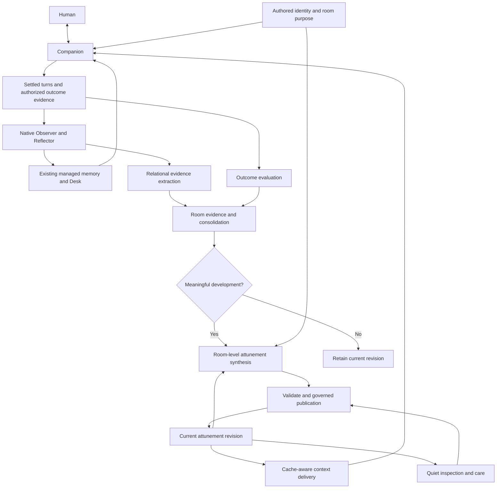

# Quellight Phase 4 — Attunement specification

**Version:** 0.1.0 — pre-identity design baseline  
**Date:** 27 November 2026  
**Status:** Consolidated design for owner review; not authorization to implement or deploy.  
**Repository:** `radz2291/VICT-Quellight-02`  
**Inspected main:** `14b6ccaf6f409eac3e041dc3d9abd0bb9f875344` (26 November 2026)

This document is the canonical Phase 4 design reference. After identity review and owner acceptance, the approved revision will govern implementation and Rolladice Work tickets. Tickets are bounded work packages subordinate to this specification, not independent sources of product direction. Research evidence and delivery reports establish observed facts; they do not silently revise requirements. Record changes to this document explicitly and obtain owner agreement on consequential deviations before implementation.

## 1. Product intent

Quellight is a companion, not an assistant defined by task obedience. Attunement is the continuous development of a complementary intelligence relationship between the human and Quellight, through which Quellight develops its understanding, reasoning posture and appropriate agency to turn the human's intentions into coherent, amplified outcomes.

The human may understand a desired outcome externally without knowing the internal requirements, mechanisms, contradictions or obstacles necessary to realize it. The companion must contribute independent knowledge, reasoning and judgment to close those gaps. It may assume a complementary role quite different from the human's role. It should help the human become more capable, rather than making them learn to micromanage AI.

Amplify the underlying legitimate intention, not every belief, instruction or mistake. Challenge assumptions constructively; distinguish user goals from proposed means; preserve human authority over decisions and permission boundaries. Do not infer permission to act from an inferred preference or desired outcome.

The ambition is an order-of-magnitude increase in the value of collaboration (the owner's 10× aspiration). It is not a guaranteed multiplier, a model capability claim or an arbitrary quantitative release gate. Establish whether attunement materially improves objective outcome quality and lowers avoidable human supervision compared with an otherwise equivalent unattuned companion.

### 1.1 Representative outcomes (not predefined modes)

| Domain | Human contribution | Complementary intelligence | Desired evidence of amplification |
| --- | --- | --- | --- |
| Software product development | Desired experiences, product vision, product decisions; potentially no coding expertise | Translate incomplete experience-level requirements into coherent architecture, expose hidden requirements and trade-offs, exercise routine engineering judgment within scope | A high-quality, implementable specification or authorized implementation that addresses reliability, security, persistence, integration and verification without technical babysitting |
| Trading | Market interests, technical analysis and trading judgment; potentially no fundamental knowledge | Macroeconomic and fundamental research, causal reasoning, uncertainty and catalyst analysis appropriate to the human's approach | A useful, evidence-grounded fundamental thesis with clear invalidation conditions; no historical data leakage, guaranteed returns or unsolicited trading execution |
| Health inquiry | Health objectives, observations and interest in causal understanding | Investigate underlying biology, mechanisms, enabling conditions, limiting factors and strength of evidence | A practical, evidence-calibrated explanation of plausible paths toward the objective, including uncertainties, risks and appropriate medical evaluation; neither uncritical conventional advice nor unsupported rejection of established care |

These domains illustrate the same architecture. Do not hardcode role categories, domain personalities or templates masquerading as learned understanding. The companion should discover the appropriate role through experience.

### 1.2 Product principles (normative)

- **Autonomous learning:** no per-memory or per-attunement approval, no required conversation closure, no need to manually configure the relationship.
- **Complementary agency:** resolve missing requirements and contradictions, recognize limits and capabilities, contribute appropriate expertise, challenge when warranted, respect explicit decisions.
- **Evolving interpretation:** learn from corrections, changing abilities, evidence and actual outcomes; retain uncertainty and exceptions; avoid static profiling and self-reinforcing assumptions.
- **Quiet transparency:** all meaningful product-owned learning state, evidence, activity and effective configuration are accessible on demand. Do not clutter the conversation or require supervision.
- **Efficient execution:** protect foreground interaction, preserve prompt caching where practical, avoid redundant inference and unbounded context growth.
- **Room continuity:** shared learning across conversations within one room, without implicit cross-room attunement.
- **Truthful, user-governed state:** attributable sources, correction, restoration and forgetting; no fabricated learning, tool results, evaluations or historical context.

## 2. Boundaries and existing baseline

Phase 0 established the application foundation. Phase 1 delivered persistent conversations and rooms. Phase 2 delivered governed Mastra-native message history, thread Observational Memory (OM), shared personal Working Memory and original-source recall, with automatic learning, settings, prompt configuration, correction, forgetting and quiet inspection. Phase 3 delivered the collaborative Desk and an independent learned method.

| Layer | Responsibility | Scope |
| --- | --- | --- |
| Identity | Foundational companion orientation and values | App-level authored policy |
| Personal memory | Stable personal facts and preferences | Owner, where room settings permit |
| Observational Memory | What happened and what matters in a conversation | Native thread |
| Source recall | Access to authorized earlier evidence | Existing current-room or explicit same-owner policy |
| Desk | Shared authored and agent-produced work, artifacts and revisions | Room |
| Room method | Practical instructions for working on the room's Desk | Room; currently learned from eligible successful agent-created items |
| Attunement | Evolving understanding of the relationship, complementary role and appropriate contribution | Room |
| Current conversation | Situated intent and immediate circumstances | Turn/thread |

Room method and attunement must remain distinct. Method may teach how to produce a specification; attunement should understand why the human needs the specification, what they may be unable to articulate, and which expertise the companion should contribute. An ordinary conversation without any Desk operation must be able to teach attunement.

Do not replace the existing memory engine, repurpose the Desk method as attunement, or introduce a second conversational runtime. Preserve existing data and user-authored settings. Semantic/vector search, a general digest system, ARA migration, broad multi-user enablement, tool expansion and advanced identity development are outside the present scope.

### 2.1 Identity boundary and deferred review

Use the existing neutral companion baseline while designing and qualifying mechanisms. The current conversation prompt already uses the term companion. The owner's niche identity prompt has deliberately not been supplied or incorporated into this revision.

The infrastructure must remain identity-agnostic, while allowing product-owned learning orientation and companion execution to be conditioned by an authored, versioned identity. Identity and learned attunement must be distinguishable, versionable, and independently inspectable. Attunement must not rewrite identity, authored room purpose or explicit instructions, grant capabilities, or override constraints.

After this pre-identity baseline is established, review the actual identity prompt in a separate design discussion. Determine what is stable, what may emerge relationally, how the learning process should be conditioned and whether existing design needs revision. Pin identity/learning-policy revisions where applicable. If the identity changes later, preserve source evidence and historical revisions and allow deliberate, source-grounded reconsideration rather than silently rewriting past records.

**Gate:** no final attunement prompt, production implementation, or release authorization is implied by this document. Revise and approve the specification after the identity discussion. Do not invent or preempt the identity philosophy.

## 3. Logical architecture

The logical roles below are responsibilities, not a requirement for separate model calls or services.

**Foreground:** the companion receives the selected current attunement and applies it with normal reasoning to the current request. No `update_attunement` tool, compulsory self-reflection step, or extra inference before every reply. Do not expose automatic attunement-writing authority to the conversational companion. Ordinary conversation and existing authorized actions remain primary.

**Background:** collect and interpret eligible evidence, synthesize room-level understanding selectively, validate and publish a versioned result, or retain the current state. Learn from actual collaboration, not from an assumption that every message is a new permanent preference.

### 3.1 Evidence interpretation

Capture relevant user statements, clarifications, corrections, accepted/rejected proposals, demonstrated domain skills, expressed or inferred goals, delegation patterns, unarticulated requirements, failures, and confirmed outcomes. Distinguish observed facts, user-authored guidance, inferred interpretations and evaluator judgments. Do not infer unsupported personal characteristics or treat model-generated claims as proof of user preferences or outcomes. A successful tool receipt proves the recorded action, not automatically the quality of the result.

Prefer existing eligible native observations/extractions and source IDs. Use raw sources selectively where an interpretation needs verification. Preserve provenance and uncertainty; avoid copying entire histories into a parallel memory store.

### 3.2 Relational synthesis

Derive a coherent, compact understanding from relevant new evidence, prior valid state, authored purpose and applicable guidance. The process should discover relationships not explicitly described by the human, without manufacturing certainty.

The following are conceptual dimensions, not a required fixed schema for thought: objectives and intent; human orientation and capabilities; gaps and complementary contribution; expected standards; appropriate division of responsibilities; when to follow, challenge, investigate, teach or proceed; conditions, exceptions and unresolved uncertainty; evidence of change. Store flexible model-facing guidance inside a strictly validated and attributable product envelope.

A candidate may add, refine, qualify, retire or leave unchanged an interpretation. No meaningful change must be a normal outcome, not a failure or a reason to create another published revision.

### 3.3 Situated alignment

At inference time, apply attunement as contextual guidance, not a rigid instruction list. Current explicit intent and owner corrections govern; inferred guidance must be defeasible. Resolve routine gaps independently within authorized scope. Surface consequential or irreversible decisions and genuine ambiguity rather than substituting a hidden agenda. Recognize when an ordinary task needs no extra collaboration ceremony.

Do not expand the model's tools or permissions merely because an attunement record proposes greater initiative. Domain expertise, external evidence, credentials and execution access remain independent capabilities.

### 3.4 Outcome reflection

Use confirmed user feedback, accepted or rejected results, verified artifacts/tests, and relevant authorized tool receipts. Distinguish actual outcomes from self-evaluation, predicted outcomes and conversational satisfaction. A scorer is fallible evidence, not authority or ground truth. Feedback must be able to modify or retire an established interpretation. Do not optimize for agreement, engagement or dependence.

## 4. Mastra-first implementation strategy

Prefer extending intelligence processes already present in Quellight. Candidate mechanisms require installed-version, VICT and live-provider qualification before adoption.

| Upstream capability | Intended use | Status |
| --- | --- | --- |
| Observer/Reflector Extractors | Derive relational evidence while performing native memory processing; compare text and structured forms | First candidate; verify installed API, quality, provenance, inference cost and failure isolation |
| Memory Hooks / completion events | Observe actual lifecycle, collect usage and enqueue downstream synthesis after durable eligible evidence is committed | First candidate; stream events/hooks alone are not durable scheduling proof |
| State Signals | Deliver changed attunement snapshots/deltas without repeatedly rewriting the early prompt; deduplicate unchanged values | First cache-aware candidate; qualify exact context placement, replay, compaction and forgetting |
| Scorers, datasets, experiments | Compare collaboration quality and collect sampled outcome assessments | Investigate; use where useful, not mandatory on every turn |
| Native OM, Working Memory and recall | Retain current distinct memory responsibilities | Preserve and measure |
| Processors or app context composition | Alternative/bridge for delivering attunement if native signals cannot satisfy guarantees | Conditional; no duplicate injection |
| Dedicated governed synthesis | Combine evidence across conversations into a room-level interpretation | Required logical role; choose native reuse or separate bounded background inference based on proof |

Upstream documents describe text extractors as part of memory processing, structured extraction, hooks, and cache-aware state signals. Do not assume particular call counts, exact API signatures or support from an upstream version number alone. Quellight's current lock pins `@mastra/core 1.64.0`, `@mastra/memory 1.28.2`, `@mastra/pg 1.22.3` and `@victframework/mastra 0.4.0-rc.1`; the actual VICT Mastra archive is the VHOST-028 successor identified in `baseline.json`. The inspected `native.ts` maps observation/reflection additions, personal Working Memory and recall; it does not configure extractors. Public recoverable adapter support for candidates is not yet established.

Qualify in the installed artifact closure. If VICT needs extension, expose generic, reusable and identity-agnostic mechanisms through its public contracts; Quellight owns the prompts, room policies and UX. Do not bypass VICT with raw Mastra or provider loops, directly mutate native storage, or hardcode Quellight philosophy in framework packages. Respect read-only reference checkouts and prove new public capabilities in isolated consumers before product adoption.

Preferred result: use Observer/Reflector extraction for evidence, selectively synthesize at room level, and deliver cache-aware revisions. If extracts are too shallow or unreliable, compare with a dedicated background interpretation call. Record the evidence and trade-off; do not silently fall back or add a pipeline just because it is convenient.

## 5. Learning timing and lifecycle

**Continuous evidence, selective evolution.** Observe on existing eligible native cycles; adapt in the present conversation every turn without necessarily persisting a new attunement. Synthesize from meaningful experiences rather than a mandatory turn count, whole-conversation completion event, or the Reflector compression threshold alone.

| Signal | Expected policy |
| --- | --- |
| Greeting, routine factual turn, no relational change | Retain state; avoid unnecessary synthesis |
| Emerging patterns or weak evidence | Accumulate; do not prematurely publish a generalization |
| Consequential clarification, complementary role discovery, contradiction | Prioritize evaluation and possible revision |
| Explicit owner correction in UI | Take effect at the next admissible turn without waiting for model synthesis |
| Correction in ordinary conversation | Respect immediately in current conversation; prioritize durable background learning |
| Confirmed success/failure or change in user capability | Evaluate whether it changes the relationship |

Exact triggers, debounce/coalescing, thresholds and significance detection are research outputs, not arbitrarily fixed here. Preserve short-conversation learning, including one consequential exchange; do not require the user to close a tab or conversation. Background work must yield to foreground work and not cause avoidable delays or starvation.

Reuse the existing signed maintenance delivery, claim/reconciliation and owner-scoped worker patterns. Enqueue from committed eligible evidence; pin actor, room, sources/digest, authority, configuration, prompt/model identity, prior attunement revision and operation identity. Distinguish queued, running, prepared, published, unchanged/skipped, superseded, retryable and blocked/failed facts. Publish atomically under revision and authority fences; recover a completed/prepared operation without regenerating; do not fabricate completed receipts for interrupted work. Preserve last valid state on provider failure. Coalesce repeated evidence without losing corrections or independent outcomes. Multi-device and cross-thread concurrency must not lose newer updates.

Do not reuse a native reflect job label to disguise a product synthesis operation. Reuse qualified infrastructure where appropriate and keep logical responsibilities, receipts and source ownership explicit. Respect actual host ceilings; do not impose artificial conversational inference timeouts, output caps or step caps.

## 6. State, scope and longitudinal design

Attunement is shared across all eligible conversations in the same owner/room, including new conversations and reopened older ones. Home follows the same rule. Do not automatically promote local room understanding into personal memory or apply another room's attunement. Existing broader recall settings do not implicitly broaden attunement scope. Explicit future cross-room learning would need a separate product decision.

Separate:

1. **Active attunement:** compact current synthesized understanding used in normal conversation.
2. **Relational knowledge:** consolidated, attributable experiences/patterns, outcomes and uncertainties used selectively in synthesis or deliberate retrieval.
3. **Historical evidence:** original source references, revision history, activity, evaluations and corrections retained for inspection and source-grounded reconsideration.

The state envelope must identify owner/room, immutable version and parent, author/authority, timestamps, applicable configuration/identity/prompt/model versions, source references and revisions, and current eligibility. Keep generated content separate from owner-authored corrections. Version records must be portable across model/provider changes. Choose actual schema and indexes after capability investigation; do not confuse this conceptual contract with a decided migration.

Normal turns must not scan or inject all room history. Active context must remain bounded by a measured context policy independent of conversation count; consolidate selectively, page/index history and retrieve sources only as warranted. Maintain valid evidence, distinguish historical from current understanding, resist drift from repeated summarization, and support reconsideration from original sources. Newer evidence should not erase enduring knowledge blindly.

Simulate 10, 100 and 1,000+ conversations and changes over a 5–10-year room lifespan, including growth in human expertise, stale/contradictory evidence, changes of domain purpose, source forgetting and provider/model replacement. Measure context size, query/egress growth, source retrieval, update cost, fidelity and correction. Simulations do not establish actual decade-long operational reliability. Quantify free-host capacity and limits; do not promise unlimited physical storage or charge for new infrastructure. No silent destructive archival or history deletion.

## 7. Context, authority and care

Keep a single native managed memory selection path. Attunement is an additional separately attributed product context, not a duplicate raw history injection or mutable system-identity rewrite.

Foreground admission pins the attunement selected for that run. Apply valid guidance in subsequent turns, including new threads; no ordinary mid-turn revision replacement required. Clearly distinguish selected guidance from actual model-facing delivery. A context record establishes what was supplied, not private reasoning or proof that it caused a particular sentence.

User corrections may address one interpretation without freezing unrelated learning. Prove that a correction is immediately authoritative for subsequent admission and survives older queued synthesis/retries, while unrelated state continues evolving. Support inspection, correction, restoration and source forgetting. Restore creates a new authorized revision, never silently reactivates invalidated source-derived material. Owner-authored content is distinguished from inferred content; explain when a separately authored statement must be edited independently.

Extend existing source-authority exclusion/quarantine and stale-publication fencing to extracted values, consolidation, evaluations, attunement revisions, any cached state signals and subsequent agent-derived records. Forgetting must exclude affected sources from future model context and learning, including queued and regenerated results; preserve original readable transcripts and historical evidence as existing product policy permits, with truthful UI labels. Source exclusion is not a guarantee of semantic erasure of independently supplied information. A correction or forget action must not be defeated by an earlier appended signal, old snapshot, retry or OM reflection. Rebuild/rebase context when correctness requires it even if a cache miss results. No cache optimization outranks authority.

Enforce owner/room authorization below the UI, with trusted server policy for exact allowed automatic effects. Sources are data, not instructions to change authority. No secrets, credentials or private model reasoning in user-facing operational records.

## 8. Token efficiency and cache qualification (mandatory gate)

The owner specifically requires investigation of existing memory efficiency as well as new attunement overhead. This is a blocking engineering investigation before deciding the implementation route.

The inspected `native-policy.json` uses `lastMessages: 1000` and `observation.messageTokens: 1` to support short-chat learning. Upstream OM defaults differ (current docs describe 30,000 message tokens and 40,000 observation tokens). These are triggers/selection settings, not generation caps. Do not assume this configuration is inefficient or optimal without actual measurements. Do not change it blindly or regress short-chat learning.

### 8.1 Baseline and comparative experiments

- Verify current VICT/Mastra message ordering and selected model-facing context, native OM activation/compaction, personal profile and Desk injection, existing maintenance scheduling, provider cache semantics and what usage fields Z.AI Coding Plan actually returns. Inspect the precise installed package and adapter, not just latest documentation.
- Run matched synthetic short chats and continuous 100+ turn chats on the same qualified GLM-5.3-Flash profile. Separate first/cold requests, warm consecutive turns, idle/cache expiry, reflection, personal memory changes, Desk changes and attunement changes. Preserve model/provider defaults.
- Compare current configuration, candidate memory threshold/buffering/idle policies (if supported), attunement disabled, stable/changed early injection, and qualified State Signals or another cache-aware delivery design. Compare extractor text versus schema and any dedicated synthesis on the same evidence and quality criteria.
- Record input, cached input, uncached input, output and total tokens where reported; request counts by role, model and operation; provider usage/quota indicators where available; time to first token, completion latency, background delay and contention; database bytes/reads and storage growth. Distinguish estimated tokens from provider-reported counts, billing from quota, and missing metrics from zero.
- Inspect signal snapshot/delta deduplication, persistence across reopen, injection after prior history, context-window/OM compaction, new-thread initial snapshot, stale revisions, correction/forgetting, and protection against accumulated signal bloat. Verify actual provider cache behavior, not merely a stable-looking prompt.
- Protect foreground work and source authority; compare quality as well as resource savings. Establish numeric regression tolerances and workload-specific budgets from evidence and agree them before the product release gate.

Do not publish a new attunement version or signal for unchanged guidance. Prefer compact state, stable prefixes, selective deltas and batched background inference where safe. Exact placement and delivery contract are subject to proof; no claim that State Signals automatically preserve GLM cache hits. If cached-token usage is not exposed, report that limitation and any proxy measurement separately. Never represent a cache estimate as provider telemetry.

## 9. Quiet transparency and user experience (mandatory)

Conversation stays primary. Extend existing ready-made VICT controls and inspection patterns, not a new dashboard or separate UI kit. Suggested entry: conversation More → Memory → Attunement, clearly labelled as room-scoped, with related configuration reachable on demand. Final placement may be refined in local desktop/phone review without removing access.

| View | Required actual information |
| --- | --- |
| Current understanding | Active interpretation, complementary role, scope, revision, uncertainty and applicable corrections |
| Evidence and sources | Meaningful Observer/Reflector extractions and supporting original source links, distinct from interpretations |
| Evolution | Current/prior revisions, differences, reason/evidence for change, superseded/invalidated state |
| Synthesis and activity | Recorded inputs/outputs, eligible occurrences, queued/running/prepared/published/unchanged/failure status and recovery |
| Outcome evaluation | Actual available scorer results, user feedback, verified outcomes, limitations; distinguish predictions and judgments |
| Reply context | Attunement selection and actual delivery for the selected reply, separately from current state and native memory/Desk context |
| Prompts and configuration | Effective authored learning prompts, versions, model role, inherited settings and room overrides; identity boundary |
| Resource usage | Actual recorded tokens, cache fields and relevant role-specific activity/latency where exposed; unknown/unavailable clearly labelled |
| Care | Correct individual understanding, inspect history, restore eligible revisions, forget sources, learning controls and eligible retry |

These are functional requirements for implemented capabilities, not permission to display mock records as live or promise unimplemented evaluations. Opening an inspector only reads/subscribes. No per-event approval, intrusive notifications, hidden background writes from the inspector, or compulsory memory management. Preserve existing conversation draft, focus, navigation, device accessibility, light/dark and actual saved state. Configuration changes affect future work, pin in-flight semantics, preserve explicit overrides, and are versioned.

Expose meaningful state and under-the-hood operational facts; do not expose private model chain-of-thought, secrets or raw privileged provider metadata. Generated explanations, summaries and judgments must be labeled and not substituted for historical execution facts. Use existing `vict.application@3` composition and installed public controls, per AGENTS.md.

## 10. Development sequence and decision gates

These are proposed bounded increments; the owner authorizes each consequential direction and actual ticket creation separately. No tickets are created by adopting this design.

| Increment | Goal | Exit gate |
| --- | --- | --- |
| 4P — Pre-implementation design review | Review this baseline and then the owner's separate identity prompt; revise and approve canonical specification | Owner confirms revised scope and authorization |
| 4R — Research and qualification | Establish cache/memory baseline; qualify native Extractors, Hooks/events, State Signals and Scorers; compare evidence quality and alternative paths; identify any generic VICT extension | Installed proof, actual provider measurements or disclosed gaps, documented choice and agreed budgets; no product rollout |
| 4A — First vertical slice: relational attunement | One complete room-scoped evidence → synthesis → application → correction/feedback loop, quiet inspection, cache-aware delivery | Matched comparative software scenario and authority/recovery checks; owner evaluates actual experience |
| 4B — Situated agency | Deepen application to ambiguous objectives and complementary responsibility; contextual exceptions | Novel held-out tasks show meaningful benefit without overstepping |
| 4C — Outcome learning | Incorporate confirmed outcomes and selectively qualified scorers, with calibration | Success/failure evidence refines understanding without self-reinforcement |
| 4D — Longitudinal evolution | Consolidation, selective retrieval, changing abilities and model/identity revisions | Simulated longitudinal quality, storage, latency and correction tests |
| 4E — Integrated qualification/release | Cross-domain comparative assessment, independent review, actual hosted desktop/phone journeys and recovery | Agreed evidence gates, owner acceptance and explicit deployment authorization |

4A must already contain a meaningful complete learning loop, not a preference demo. Baseline care, outcome feedback, room scope, observability and cache safeguards are not deferred to later increments; subsequent increments deepen them. Avoid building a large speculative system ahead of evidence.

## 11. Acceptance methodology — prove amplification, not personalization

First run a small paired, held-out experiment in software product development. Use the same model/profile, identity, current prompt, tools, native memory capabilities, eligible prior experiences, task and permitted access. The control lacks the learned attunement layer; the candidate has the learned state. Do not disable ordinary memory in the control or leak target answers into learning evidence. Retain exact input identities and all outputs; use independent evaluation where possible, blind reviewers to condition, multiple novel cases/repeats to reduce sampling variance. Record failures honestly and compare against the unchanged current app.

Learning experience: several ordinary conversations demonstrate the human expressing product outcomes without implementation detail, correcting unhelpful technical handoffs, retaining consequential product decisions and accepting evidence-based engineering judgment. Include a contradiction and an actual correction, and avoid explicitly supplying a ready-made attunement profile. No Desk create receipt required. The held-out task is a new incomplete but meaningful product vision, not the training project.

The candidate should produce a materially more coherent, ready-to-implement specification within authorized scope: independently derive relevant missing technical requirements, surface real conflicts and trade-offs, explain externally meaningful consequences, avoid unnecessary questions, and identify objective verification. If authorized implementation tools are unavailable, assess the specification/artifact, not imagined execution.

Measure with a predefined domain rubric and recorded outcomes: intent fidelity, requirement completeness, coherence, correctness, security/reliability considerations, appropriate independent judgment, consequential assumptions surfaced, factual/evidence quality, unnecessary supervision (human interventions, corrective instructions and effort), latency/token overhead and respect for authority. Agree quality/non-regression thresholds before evaluation. Mere preferred wording, remembered preference, pleasant conversation or a plausible learned document is insufficient. Report 10× only if a defined metric actually supports it.

Extend later to trading (point-in-time evidence and no hindsight) and health (biological mechanism, evidence strength, uncertainty and appropriate care). Use changing human expertise and novel goals; verify the companion does not keep an outdated role. Avoid real personal health data or live trading as qualification fixtures.

### 11.1 Required behavioral and engineering cases

| Case | Required behavior |
| --- | --- |
| New/old conversation in same room | Uses latest eligible shared revision at admission; learning from ordinary chat contributes |
| Distinct rooms | No unintended attunement transfer |
| Short consequential correction | Immediate current-turn respect, durable prioritized update; no close-tab dependency |
| Trivial exchanges / unchanged evidence | No unnecessary published revision, signal or synthesis under agreed policy |
| Contradictions and exceptions | Calibrated interpretation; no sweeping unsupported profile |
| Outcome failure and success | Changes justified by observed evidence, not self-reported success |
| Correction / restore / forget | Revision-safe controls, no stale source or signal reintroduction, unrelated learning preserved |
| Concurrent sessions and worker loss | No lost update, duplicate publication or stale authority; checkpoint recovery, last valid state |
| Cache and long conversation | Baseline and candidate metrics within agreed budgets; no artificial model cap |
| Long-lived room | Compact active context, indexed/paged evidence, evolving interpretation and source-grounded reconstruction |
| Inspection | Actual sources, lifecycle, selected revision, configuration and usage visible; no hidden mutation from reading |
| Provider/model change or failure | Portable history, controlled reconsideration, truthful uncertainty; no invented success |
| Existing Phases 0–3 | Regression of conversation, memory care, Desk, settings, foreground recovery and identity/authorization behavior is prevented |

## 12. Agent execution governance

Read `AGENTS.md`, current `STATE.md`, Phase 2–3 plans/delivery and actual source before work. Re-verify latest main and artifact closure; state/delivery docs include historical releases and are not proof of the current deployed commit. Keep reference repos read-only. Use the existing free services and existing provider credential; no new paid provider, plan upgrade or nonzero incremental charge. Preserve production credentials/data and current real-owner sessions. New model-backed roles require explicit existing profile routing. Do not use real-owner conversations as test fixtures.

Use Rolladice Work only after owner agreement. The orchestrating agent assigns bounded tickets with problem, goal, scope, constraints, dependency, ownership, acceptance cases, evidence requirements and exact spec revision. Separate framework qualification, product changes, UI and independent review. Record tested commit/archive identities, exact fixtures, deterministic vs installed vs actual GLM vs hosted browser evidence, failures and limits. Use synthetic isolated Preview identities for live qualification and follow established cleanup/release authority. Keep GitHub main and production untouched until authorized. Ticket completion is not owner acceptance or a deployment claim.

## 13. Open decisions — resolve explicitly

- Identity philosophy and exact authored identity prompt: deferred separate owner review.
- Native adapter support for Extractors, Hooks/events, State Signals, Scorers and relevant OM efficiency policies; versions, recovery, source authority, usage telemetry and installed compatibility.
- Evidence extraction format, significance policy, coalescing and synthesis prompt, quality comparison with dedicated background inference.
- Cache-aware context delivery mechanism, measured budgets and regression thresholds, including impact of the one-token threshold and existing mutable context.
- Exact storage contracts/indexes, selective evidence retrieval, history/retention policy and estimated free-host capacity.
- Specific UI composition and label/placement; settings granularity and care semantics consistent with authority.
- Comparative evaluation datasets, rubric, blind review protocol and quantitative gates.
- Final ticket IDs, ownership, order and release authorization.

These are explicit qualification or owner-review items, not permission to invent final choices.

## 14. References

Repository sources inspected at the baseline commit:

- [AGENTS.md](../AGENTS.md), [STATE.md](../STATE.md), [baseline.json](../baseline.json), [package-lock.json](../package-lock.json)
- [Phase 2 plan](PHASE-2-PLAN.md), [delivery](PHASE-2-DELIVERY.md), [ARA comparison](PHASE-2-ARA-COMPARISON.md), [native composition](PHASE-2-NATIVE-COMPOSITION.md), [memory care](PHASE-2-MEMORY-CARE.md), [hosting](PHASE-2-HOSTING.md), [UI](PHASE-2-UI.md)
- [Phase 3 plan](PHASE-3-PLAN.md), [delivery](PHASE-3-DELIVERY.md), [Desk backend](PHASE-3-DESK-BACKEND.md)
- [Prompts and context](PROMPTS-AND-CONTEXT.md), [owner guide](USING-QUELLIGHT.md), [local UI preview](LOCAL-UI-PREVIEW.md)
- [Native adapter composition](../src/lib/server/memory/native.ts), [native policy](../src/lib/server/memory/native-policy.json), [memory worker](../src/lib/server/memory/worker.ts), [dispatcher](../src/lib/server/memory/dispatcher.ts), [conversation activation](../src/lib/server/conversation/activation.ts), [conversation prompt](../src/lib/server/prompts/conversation.json), [memory catalog](../src/lib/server/prompts/memory-catalog.json), [Desk method prompt](../src/lib/server/prompts/desk-method.json)

Upstream research leads (consult exact installed source during qualification; current docs may describe newer APIs):

- [Mastra OM](https://mastra.ai/docs/memory/observational-memory)
- [Memory Extractors](https://mastra.ai/blog/introducing-memory-extractors)
- [Memory Hooks](https://mastra.ai/blog/introducing-memory-hooks)
- [State Signals](https://mastra.ai/docs/signals/state-signals)
- [Agent Signals architecture](https://mastra.ai/blog/announcing-agent-signals)
- [Scorers](https://mastra.ai/blog/mastra-scorers)
- [Studio evaluation, datasets and experiments](https://mastra.ai/docs/studio/overview)

## 15. Revision history

| Revision | Date | Change |
| --- | --- | --- |
| 0.1.0 | 2026-11-27 | Consolidate Phase 4 discussion into pre-identity design baseline, with mandatory native-capability/cache research, quiet transparency, room continuity and longitudinal qualification. No implementation approval. |

